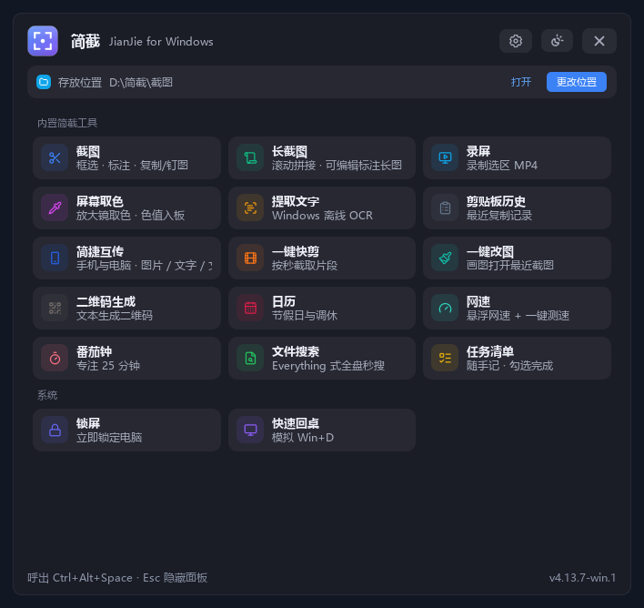
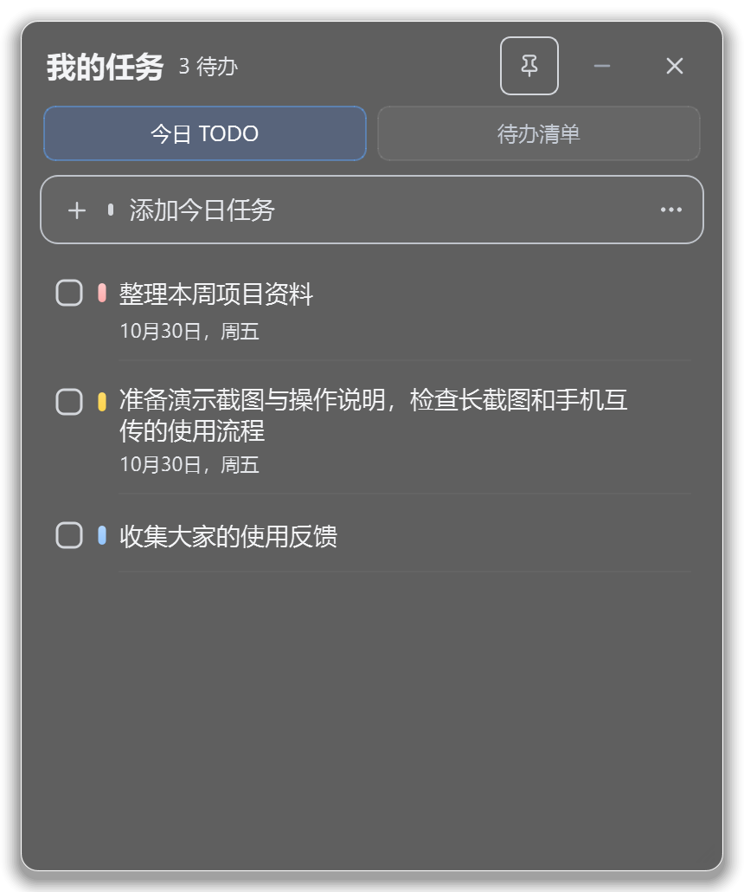
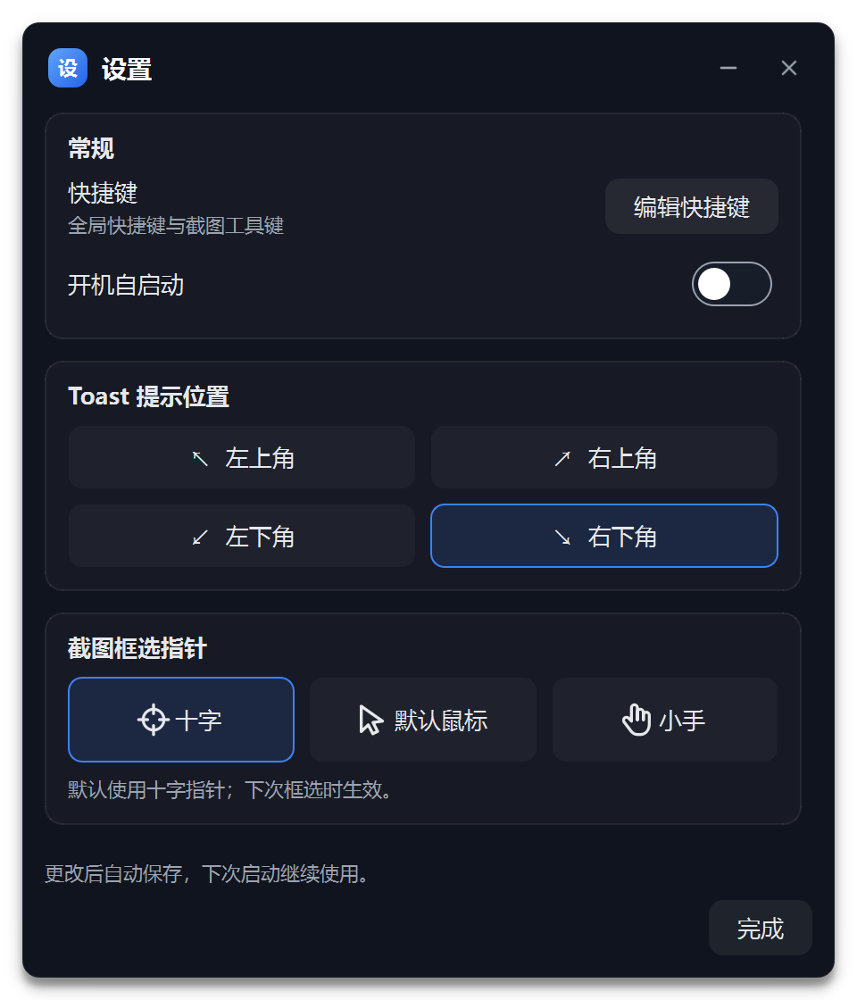
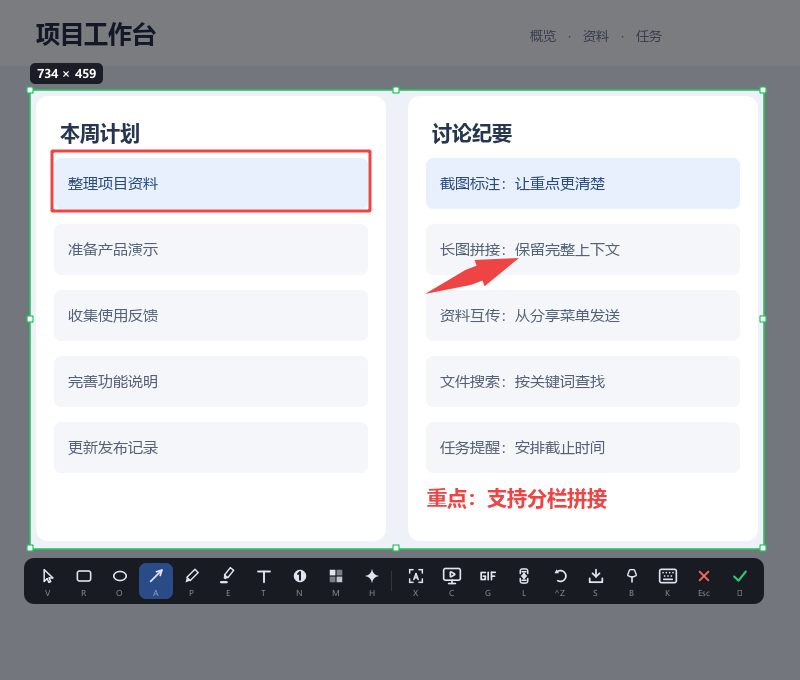
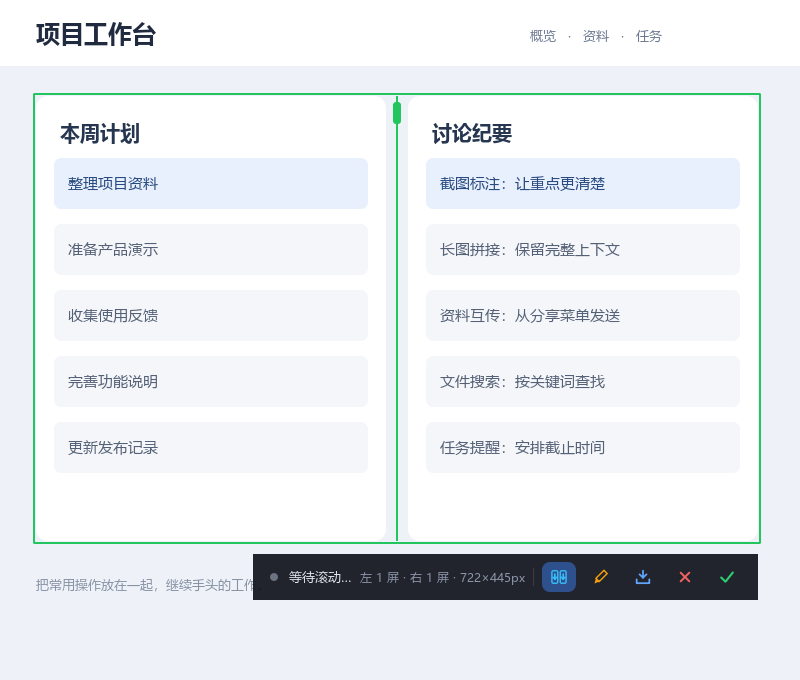
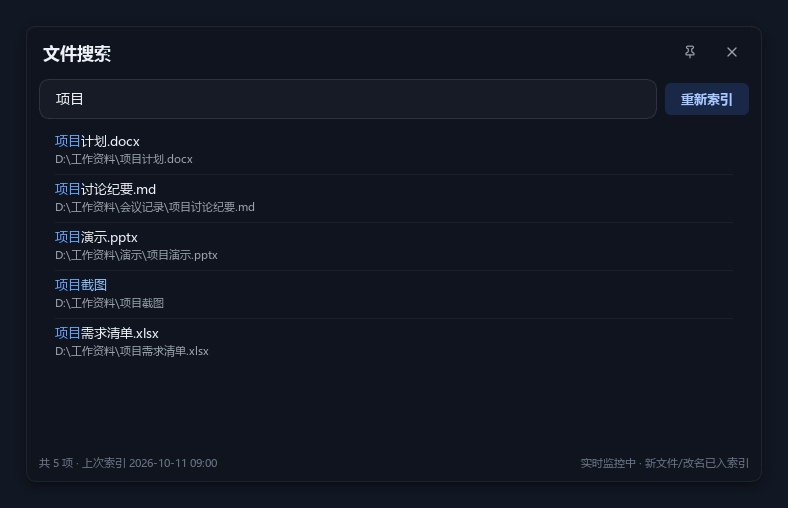
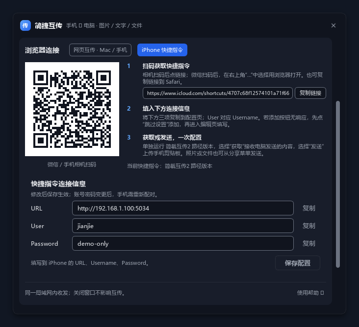

# 简截 · JianJie

这是我个人 web coding 做的一款 Windows 小工具。参考了一些大神的开源项目，也结合了自己平时工作里经常遇到的场景，一边用、一边改，慢慢做成了现在这样。

在我自己的日常工作里，它已经替代了不少原来常用的软件：截图用的 PixPin、付费的录屏工具、搜文件用的 Everything，还有记任务用的滴答清单。现在这些需求基本都能在简截里完成，对我来说，它已经是一款每天都在用的工具了。

分享出来，欢迎大家下载体验，也欢迎提建议。

**一个 EXE，把截图、长截图、录屏、文件搜索和手机互传放到一起。**

简截是一款 Windows 桌面效率工具。用快捷键随时呼出，截取内容、标注说明、查找文件、传送资料，再继续手头的工作。

## 特点

1. **单个 EXE，轻装运行。** 当前完整包约 **39 MB**，免安装，双击即用。功能按需加载，后台索引限制缓存占用；实机运行快照的工作集合计约 **86 MiB**，作为常驻内存参考。[^memory]
2. **截图之后，接着做。** 框选或自动定位窗口，支持箭头、文字、形状、马赛克和钉图；同一选区可以直接转成长截图、GIF 或录屏，减少重复框选和工具切换。
3. **长截图，左右分栏独立拼接。** 支持单栏与双栏模式，可拖动调整分栏宽度。左右两栏分别滚动、分别拼接，适合同时截取并排的两块内容，完成后继续编辑标注。
4. **文件搜索，索引留在本地。** 像 Everything 一样随输随查，面向秒级响应：启动后自动在后台准备索引，复用已有数据并跟踪文件变化。C++ 搜索内核支持中文和多个关键词，匹配内容以颜色突出显示，让查找文件更直接。
5. **手机与电脑，扫码互传。** 同一局域网内，通过浏览器双向收发图片、文字和文件，接收端无需安装专用 App。iPhone 添加并配置快捷指令后，通过“获取”和“发送”两个菜单收发内容，也可以从照片或文件的分享菜单直接发送到电脑，传输顺手、少几次跳转。
6. **按自己的习惯设置。** 自定义全局快捷键和截图工具键，让常用操作一按就到；提示可放在屏幕四角，避开工作窗口。截图指针可选十字、默认鼠标或小手，支持开机自启动、明暗主题与自定义存储位置，任务清单也会记住调整后的窗口尺寸。

[下载 Windows 完整版](https://github.com/VampireQW/jianjie/releases/latest) · [访问官网](https://jianjie-4b7.pages.dev/)



*以下界面使用演示内容和示例连接信息。*

## 功能一览

| 功能 | 可以做什么 |
| --- | --- |
| 截图与标注 | 自动定位窗口、自由框选、截取屏幕浮窗，添加箭头、文字、形状与马赛克，复制或钉在屏幕上 |
| 长截图 | 滚动拼接长图，支持单栏与双栏模式，拼接完成后继续编辑 |
| GIF 录制 | 将选区录成动图，复制到剪贴板或保存为 GIF 文件 |
| 录屏 | 录制选区并输出 MP4，可选 30、40、50、60 fps |
| 屏幕取色 | 放大查看像素，复制色值；也可在截图框选时直接使用 |
| 文字识别 | 调用 Windows 系统 OCR，从截图中提取文字 |
| 文件搜索 | 搜索文件与文件夹，支持空格分隔多个关键词、匹配高亮和文件操作 |
| 简捷互传 | 手机与电脑双向传送图片、文字和文件，支持扫码网页和 iPhone 快捷指令 |
| 任务清单 | 多行任务、完成勾选、优先级、截止日期和提醒，可调整并记住窗口尺寸 |
| 剪贴板历史 | 查看最近复制的图片，以自适应卡片预览，并再次复制、编辑或钉图 |
| 桌面小工具 | 番茄钟、日历、网速与测速、二维码生成 |
| 其他操作 | 按秒裁剪视频、调用画图编辑截图、锁屏、快速回到桌面 |

<details>
<summary>查看任务清单与设置界面</summary>

<table>
<tr><th>任务清单</th><th>集中设置</th></tr>
<tr>
<td></td>
<td></td>
</tr>
</table>

</details>

## 下载与使用

适用于 **Windows 10 / 11，64 位**。

1. 从 [Releases](https://github.com/VampireQW/jianjie/releases/latest) 下载 `JianJie.exe`（简截完整版），放在准备长期使用的文件夹中。
2. 双击运行，无需安装 Python。
3. 从主面板点击功能，或使用全局快捷键直接触发。
4. 点击右上角齿轮，修改快捷键、提示位置、开机自启动和截图指针。

关闭主面板后，简截仍会驻留系统托盘。需要结束运行时，在托盘菜单中选择“退出简截”。

### 默认快捷键

| 操作 | 快捷键 |
| --- | --- |
| 呼出主面板 | `Ctrl+Alt+Space` |
| 截图 | `Ctrl+Alt+A` |
| 长截图 | `Ctrl+Alt+S` |
| 录屏 | `Ctrl+Alt+R` |
| 屏幕取色 | `Ctrl+Alt+C` |
| 文件搜索 | `Ctrl+Alt+F` |
| 显示 / 隐藏任务清单 | `Alt+N` |

以上键位均可在设置中修改。截图标注工具也支持自定义工具键。

## 几个常用操作

### 截图、复制与保存

- 触发截图后，可自动定位窗口，也可拖动鼠标框选区域。
- 框选时按 `Ctrl+C`，复制当前光标位置的色值。
- 截图和长截图完成后，按 `Enter` 或点击对号复制到剪贴板。
- GIF 和录屏点击对号时，复制的是媒体文件引用，可粘贴到支持文件的聊天窗口或资源管理器。
- **点击下载按钮，才会把成品保存到指定目录。** 复制操作使用剪贴板或内部缓存，不会额外向成品目录保存一份。
- 在截图、长截图、GIF 或录屏的选区状态下，按 `Esc` 或鼠标右键取消。



### 双栏长截图

框选同时包含左右两栏的区域，在工具条中切换到双栏模式，先调整分栏线，再分别向下缓慢滚动左右两栏。两栏各自拼接，最终顶部对齐合成为一张长图，较短一栏的底部补黑。



### 文件搜索

输入文件名关键词即可查找，多个关键词用空格分隔。匹配内容用颜色突出显示，路径在下方弱化显示；双击打开，右键可进行更多文件操作。



### 手机互传

让手机与电脑连接同一局域网，打开“简捷互传”，扫码或在浏览器中打开配对链接，即可收发图片、文字和文件。

最近互传显示最近 5 条记录，保留 30 分钟，也可以手动清空。**记录过期或清空，不会删除已保存到文件夹中的文件。**


#### iPhone 快捷发送

添加 [简截互传2 路径版本](https://www.icloud.com/shortcuts/4707c68f12574101a71f666d029996c5)，将 URL、Username 和 Password 配置为电脑互传窗口中的连接信息。

- 单独运行，选择 **“获取”**：接收电脑在互传窗口中发送的内容。
- 单独运行，选择 **“发送”**：将手机剪贴板内容发送到电脑。
- 在照片或文件的分享菜单中选择此快捷指令，也可以直接发送到电脑。

这版快捷指令的两个菜单已由作者在 iPhone 上运行确认。扫码网页仍可用于双向互传。



## 数据与存储

在主面板的存放位置入口中，可以查看、打开或修改：

- 截图、长截图、GIF 和录屏的成品目录。
- 任务清单、设置和文件索引等应用数据目录。
- 收到的互传文件目录。

更改位置时会迁移历史数据，并重新启动简截。成品直接保存到选择的文件夹。

文件索引会在启动后后台准备，首次索引或校准需要一些时间；后续搜索复用已有索引，并持续接收文件变化，无需每次打开搜索窗口都重新建立索引。

任务提醒需要简截保持运行。OCR 的可识别语言取决于系统已安装的 OCR 语言支持。

## 问题与建议

欢迎在仓库的 Issues 中提交问题或建议。遇到问题时，请附上简截版本或构建编号、Windows 版本、复现步骤，以及能说明问题的截图。

## 从源码运行与打包

开发环境为 Windows 64 位。安装 Python 后，在项目根目录执行：

```powershell
python -m venv .venv
.\.venv\Scripts\Activate.ps1
python -m pip install -r requirements.txt
```

按 [原生搜索内核构建说明](native/README.md) 准备 Zig 与 SQLite，然后编译并启动：

```powershell
python native/build.py
python main.pyw
```

生成单个完整 EXE：

```powershell
python -m pip install pyinstaller
python -m PyInstaller --noconfirm --clean 简截.spec
```

成品为 `dist/简截.exe`。打包时会重新编译 C++ 搜索内核，运行成品无需 Python 或 C++ 编译环境。

第三方组件及图标声明见 [THIRD_PARTY_NOTICES.md](THIRD_PARTY_NOTICES.md)。

[^memory]: 包体积按 R254 的 38,917,534 字节计算。内存参考来自 R253 的一次运行快照，主程序与启动器工作集合计约 85.7 MiB，当次私有内存合计约 109.3 MiB。工作集不等于全部已分配内存；这些数字是参考值，实际占用会随系统、图片大小、长截图长度和录制场景变化。
